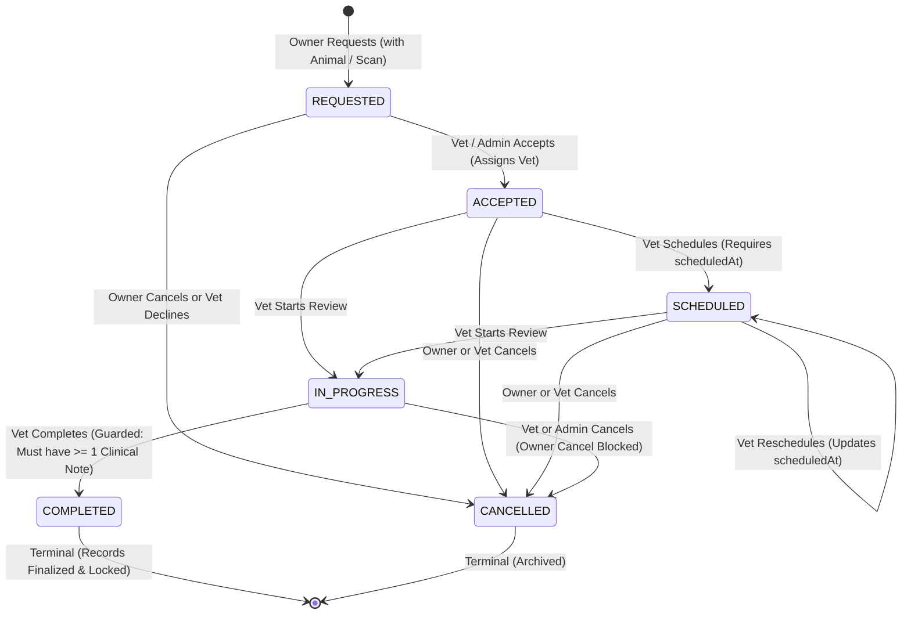

# Phase 8 — Veterinary Consultation Lifecycle & Clinical Notes Verification Report

**VetVision AI Monorepo**  
**Date:** October 27, 2026  
**Status:** Operational & Verified  
**Branch:** `main` (continuing from commit `d101f81`)  
**Test Outcomes:**
- **Backend Test Suite:** 81/81 passed across 10 test suites (including 31 new lifecycle integration tests)
- **Python AI Service:** 36/36 tests passed (35 passed, 1 dataset split skipped)
- **TypeScript Typecheck:** 0 errors across all 6 workspaces (`@vetvision/config`, `@vetvision/shared-types`, `@vetvision/validation`, `@vetvision/api`, `@vetvision/web`)
- **Web Production Bundle:** Built successfully via Vite in 16.66s

---

## 1. Executive Summary

Phase 8 implements the complete veterinary consultation lifecycle, providing a secure, audit-compliant clinical bridge linking animal owners, patient animals, diagnostic scans, licensed veterinarians, and structured clinical documentation.

Key milestones achieved:
1. **Full Lifecycle State Machine:** `REQUESTED` → `ACCEPTED` → `SCHEDULED` → `IN_PROGRESS` → `COMPLETED`, accompanied by an authenticated `CANCELLED` (or decline) workflow.
2. **Scan-to-Consultation Linkage:** Preserves exact provenance from diagnostic scans to clinical reviews, validating that attached scans belong to the specified patient animal.
3. **Mandatory Documentation Completion Guardrail:** Prevents any consultation from reaching `COMPLETED` status unless at least one structured clinical note has been authored by the attending veterinarian.
4. **Structured Clinical Notes & Owner Privacy Controls:** Implements comprehensive veterinary records (`presentingConcern`, `historyObservations`, `examinationFindings`, `assessment`, `recommendations`, `followUpDate`, `followUpInstructions`, `isOwnerVisible`). Strict server-side filtering ensures pet owners can only view notes explicitly shared by the veterinarian.
5. **Medical Record Finalization Protection:** Medical records cannot be modified or overwritten once a consultation is finalized (`COMPLETED`), preserving tamper-resistant clinical integrity.
6. **Persistent Participant Messaging:** Secure PostgreSQL dialogue per consultation, isolated strictly to verified participants (Owner, Assigned Veterinarian, Admin).
7. **Cross-Role Frontend Interfaces:** Updated Owner Consultations view with scan linkage and pre-filling, comprehensive Consultation Workspace with visual lifecycle stepper, and Veterinarian Case Reviews dashboard with an Intake Queue and quick-accept triage.

---

## 2. Features Implemented vs. Features Reused

| Subsystem | Newly Implemented (Phase 8) | Reused from Prior Phases |
| :--- | :--- | :--- |
| **Consultation Lifecycle** | Strict server-side state transition map, idempotency handling, actor/timestamp tracking, decline reasons | Session authentication, RBAC middleware |
| **Scan Integration** | `scanId` foreign key, scan verification against animal ID, embedded scan preview with AI predictions | ModelVersion registry (`efficientnetb0_lsd_v1.onnx`), FileAsset storage |
| **Clinical Documentation** | `ClinicalNote` model, structured medical form fields, owner visibility filtering, finalization locking | `HealthRecord` model (mirrored longitudinal follow-up) |
| **Messaging** | Persistent dialogue with role badges, participant authorization checks, cancellation locks | `ConsultationMessage` schema |
| **Frontend Workspace** | Visual lifecycle stepper, AI screening card with medical disclaimer, Doctor note editor, quick-accept queue | Theme tokens, Card/Modal/Badge components, AuthContext |
| **Audit Trail** | Structured `AuditLog` events on every transition, reschedule, and note creation | `AuditLog` database model |

---

## 3. Schema Changes & Database Migrations

### Prisma Schema (`prisma/schema.prisma`)

1. **`Consultation` Model Extensions:**
   ```prisma
   model Consultation {
     id             String             @id @default(uuid())
     animalId       String             @map("animal_id")
     scanId         String?            @map("scan_id")
     ownerId        String             @map("owner_id")
     veterinarianId String?            @map("veterinarian_id")
     subject        String
     description    String
     status         ConsultationStatus @default(REQUESTED)
     scheduledAt    DateTime?          @map("scheduled_at")
     startedAt      DateTime?          @map("started_at")
     completedAt    DateTime?          @map("completed_at")
     declineReason  String?            @map("decline_reason")
     createdAt      DateTime           @default(now()) @map("created_at")
     updatedAt      DateTime           @default(now()) @updatedAt @map("updated_at")

     // Relations
     animal        Animal                @relation(fields: [animalId], references: [id], onDelete: Cascade)
     scan          Scan?                 @relation(fields: [scanId], references: [id], onDelete: SetNull)
     owner         User                  @relation("ConsultationOwner", fields: [ownerId], references: [id], onDelete: Cascade)
     veterinarian  User?                 @relation("ConsultationVet", fields: [veterinarianId], references: [id], onDelete: SetNull)
     messages      ConsultationMessage[]
     clinicalNotes ClinicalNote[]

     @@index([animalId])
     @@index([scanId])
     @@index([ownerId])
     @@index([veterinarianId])
     @@index([status])
     @@map("consultations")
   }
   ```

2. **`ClinicalNote` Model (New):**
   ```prisma
   model ClinicalNote {
     id                   String        @id @default(uuid())
     consultationId       String        @map("consultation_id")
     veterinarianId       String        @map("veterinarian_id")
     presentingConcern    String?       @map("presenting_concern")
     historyObservations  String?       @map("history_observations")
     examinationFindings  String?       @map("examination_findings")
     assessment           String
     recommendations      String
     followUpDate         DateTime?     @map("follow_up_date")
     followUpInstructions String?       @map("follow_up_instructions")
     isOwnerVisible       Boolean       @default(true) @map("is_owner_visible")
     createdAt            DateTime      @default(now()) @map("created_at")
     updatedAt            DateTime      @default(now()) @updatedAt @map("updated_at")

     // Relations
     consultation         Consultation  @relation(fields: [consultationId], references: [id], onDelete: Cascade)
     veterinarian         User          @relation("VetClinicalNotes", fields: [veterinarianId], references: [id], onDelete: Cascade)

     @@index([consultationId])
     @@index([veterinarianId])
     @@index([isOwnerVisible])
     @@map("clinical_notes")
   }
   ```

3. **`Scan` Model Relation:**
   - Added `consultations Consultation[]` inverse relation.

4. **Migration & Generation:**
   - Executed `npx prisma db push` against embedded PostgreSQL on port 5432.
   - Executed `npx prisma generate` to update `@prisma/client`.
   - Updated and executed idempotent seed script `prisma/seed.ts` linking Bella's scan and seeding an initial clinical note.

---

## 4. API Endpoints Reference

All endpoints are mounted under `/api/v1/consultations` and enforce `authenticateSession`.

| Method | Endpoint | Allowed Roles | Description | Response Codes |
| :--- | :--- | :--- | :--- | :--- |
| `GET` | `/api/v1/consultations` | `OWNER`, `VETERINARIAN`, `ADMIN` | List visible consultations (filtered by role and optional `?status=`) | 200, 401 |
| `POST` | `/api/v1/consultations` | `OWNER`, `ADMIN` | Request veterinary consultation with optional scan link | 201, 400, 401, 403, 404 |
| `GET` | `/api/v1/consultations/:id` | `OWNER`, `VETERINARIAN`, `ADMIN` | Retrieve consultation details, scan, owner-filtered notes, messages | 200, 401, 403, 404 |
| `PATCH` | `/api/v1/consultations/:id/status` | `OWNER`, `VETERINARIAN`, `ADMIN` | Transition consultation status per lifecycle state machine | 200, 400, 401, 403, 404 |
| `PATCH` | `/api/v1/consultations/:id/schedule` | `VETERINARIAN`, `ADMIN` | Convenience route to schedule or reschedule appointment | 200, 400, 401, 403, 404 |
| `POST` | `/api/v1/consultations/:id/messages` | Consultation Participants | Send persistent message in consultation thread | 201, 400, 401, 403, 404 |
| `GET` | `/api/v1/consultations/:id/clinical-notes` | Consultation Participants | List clinical notes (owners receive only `isOwnerVisible: true`) | 200, 401, 403, 404 |
| `POST` | `/api/v1/consultations/:id/clinical-notes` | Attending `VETERINARIAN`, `ADMIN` | Author structured clinical note; mirrors `HealthRecord` | 201, 400, 401, 403, 404 |
| `PATCH` | `/api/v1/consultations/:id/clinical-notes/:noteId` | Authoring `VETERINARIAN`, `ADMIN` | Update clinical note before consultation completion | 200, 400, 401, 403, 404 |

---

## 5. Lifecycle Transition Table



### Transition Matrix & Guardrails

| Current State | Target State | Permitted Roles | Mandatory Preconditions & Side Effects |
| :--- | :--- | :--- | :--- |
| `REQUESTED` | `ACCEPTED` | `VETERINARIAN`, `ADMIN` | Sets `veterinarianId = user.id`. Emits `CONSULTATION_ACCEPTED` audit log and system dialogue message. |
| `REQUESTED` | `CANCELLED` | `OWNER`, `VETERINARIAN`, `ADMIN` | If Vet declines, optional `declineReason` recorded. Emits `CONSULTATION_CANCELLED` audit log. |
| `ACCEPTED` | `SCHEDULED` | Attending `VETERINARIAN`, `ADMIN` | Requires valid `scheduledAt` timestamp in payload. Emits `CONSULTATION_SCHEDULED` audit log. |
| `ACCEPTED` | `IN_PROGRESS` | Attending `VETERINARIAN`, `ADMIN` | Sets `startedAt = now()`. Emits `CONSULTATION_STARTED` audit log. |
| `ACCEPTED` | `CANCELLED` | `OWNER`, Attending `VETERINARIAN`, `ADMIN` | Records cancellation reason. |
| `SCHEDULED` | `SCHEDULED` | Attending `VETERINARIAN`, `ADMIN` | Rescheduling: updates `scheduledAt`. Emits `CONSULTATION_RESCHEDULED` audit log. |
| `SCHEDULED` | `IN_PROGRESS` | Attending `VETERINARIAN`, `ADMIN` | Sets `startedAt = now()`. Emits `CONSULTATION_STARTED` audit log. |
| `SCHEDULED` | `CANCELLED` | `OWNER`, Attending `VETERINARIAN`, `ADMIN` | Records cancellation reason. |
| `IN_PROGRESS` | `COMPLETED` | Attending `VETERINARIAN`, `ADMIN` | **CRITICAL GUARD:** Verified `prisma.clinicalNote.count > 0`. If 0, rejects with 400. Sets `completedAt = now()`. |
| `IN_PROGRESS` | `CANCELLED` | Attending `VETERINARIAN`, `ADMIN` | **Owner is blocked from cancelling once consultation is IN_PROGRESS.** |
| `COMPLETED` | *Any* | *None* | **Terminal State.** All transitions rejected with 400. Clinical records locked. |
| `CANCELLED` | *Any* | *None* | **Terminal State.** All transitions rejected with 400. Messages disabled. |

---

## 6. Clinical Note Visibility & Privacy Rules

Structured clinical notes are classified into two privacy tiers:
1. **Owner-Visible (`isOwnerVisible: true`):** Official diagnosis, treatment instructions, and return visit dates.
   - Visible to Pet Owner in the consultation workspace.
   - Synchronized to the animal's longitudinal `HealthRecord` timeline (`recordType = FOLLOW_UP`).
   - Notifies the consultation dialogue thread.
2. **Internal Vet Record (`isOwnerVisible: false`):** Differential diagnostic considerations, preliminary notes, and clinical peer-review hypotheses.
   - Exclusively visible to attending veterinarians and clinic administrators.
   - Completely omitted from owner API responses via backend filtering (`where: { isOwnerVisible: true }`).
   - Marked with an `Internal Vet Only` badge when viewed in the clinical workspace.

---

## 7. Security & Authorization Verifications

| Security Control | Implementation | Verified Status |
| :--- | :--- | :--- |
| **Authentication Enforcement** | `authenticateSession` cookie middleware checks SHA-256 token hash in PostgreSQL | Passed (401 on missing/expired session) |
| **Cross-Owner Access Isolation** | Owner cannot view or query consultations belonging to another owner | Passed (403 Forbidden) |
| **Cross-Vet Access Isolation** | Vet cannot access active consultations assigned to a different veterinarian | Passed (403 Forbidden) |
| **Intake Queue Access** | Any verified veterinarian can inspect unassigned `REQUESTED` cases to triage and accept | Passed (200 OK) |
| **Scan-Animal Mismatch Defense** | Rejects consultation requests where `scanId` does not match `animalId` | Passed (400 Bad Request) |
| **Tamper Prevention** | User cannot impersonate actors via request body IDs; actor identity extracted from session | Passed |
| **Completion Guardrail** | Blocked completion without authored clinical notes | Passed (400 Bad Request) |
| **Finalized Record Immutability** | Blocked adding or editing clinical notes after `COMPLETED` status | Passed (400 Bad Request) |
| **Message Access Control** | Only consultation participants can send messages; cancelled threads reject messages | Passed (400 / 403) |

---

## 8. Automated Test Outcomes

### Backend Test Suite (`apps/api`)
Command: `npm test`  
Result: **10 test files passed, 81 tests passed, 0 failures** in 3.35s.

```
 ✓ apps/api/test/validation.spec.ts (11 tests) 26ms
 ✓ apps/api/test/rbac.spec.ts (6 tests) 16ms
 ✓ apps/api/test/storage.spec.ts (5 tests) 15ms
 ✓ apps/api/test/ai-fallback.spec.ts (3 tests) 31ms
 ✓ apps/api/test/ai-live-e2e.spec.ts (3 tests) 117ms
 ✓ tests/integration/api-flows.spec.ts (4 tests) 256ms
 ✓ apps/api/test/integration.spec.ts (5 tests) 277ms
 ✓ apps/api/test/consultation-lifecycle.spec.ts (31 tests) 1170ms
 ✓ apps/api/test/email-otp.spec.ts (10 tests) 1390ms

 Test Files  10 passed (10)
      Tests  81 passed (81)
```

#### Detailed Breakdown of New Phase 8 Integration Tests (`consultation-lifecycle.spec.ts`):
1. **Consultation Request & Scan Linkage:**
   - Owner requests consultation with linked animal and scan (201).
   - Rejects mismatched scan that belongs to a different animal (400).
   - Rejects consultation request for an animal the user does not own (403).
2. **Complete Lifecycle State Machine:**
   - Rejects invalid jump `REQUESTED` → `COMPLETED` (400).
   - Rejects invalid jump `REQUESTED` → `IN_PROGRESS` (400).
   - Rejects unauthorized actor (owner accepting request) (403).
   - Vet accepts consultation → sets `ACCEPTED` and assigns doctor (200).
   - Rejects scheduling without `scheduledAt` timestamp (400).
   - Vet schedules consultation → sets `SCHEDULED` (200).
   - Vet reschedules consultation with new appointment date (200).
   - Rejects unassigned vet attempting to start case (403).
   - Attending vet starts consultation → sets `IN_PROGRESS` (200).
   - Guardrail: Rejects `COMPLETED` status when zero clinical notes are authored (400).
   - Owner cannot cancel an in-progress consultation (400).
3. **Clinical Notes & Owner Visibility Privacy:**
   - Rejects clinical note authoring by owner (403).
   - Attending vet authors owner-visible clinical note (201).
   - Attending vet authors private internal clinical note (`isOwnerVisible: false`) (201).
   - Owner reading clinical notes ONLY receives owner-visible notes (200).
   - Attending vet reading clinical notes receives ALL notes including internal ones (200).
   - Attending vet completes consultation once clinical documentation exists (200).
   - Rejects transition from terminal state `COMPLETED` (400).
   - Rejects editing clinical notes after consultation is completed (400).
   - Rejects adding new clinical notes after consultation is completed (400).
4. **Persistent Messaging & Access Isolation:**
   - Owner sends message in consultation thread (201).
   - Veterinarian replies to consultation message (201).
   - Unrelated owner cannot send message in this consultation (403).
   - Unrelated veterinarian cannot view active assigned consultation (403).
   - Participant retrieves chronological message dialogue (200).
5. **Decline and Cancellation Workflow:**
   - Vet declines pending `REQUESTED` consultation with declineReason (200).
   - Owner cancels their own `REQUESTED` consultation (200).
   - Rejects sending messages in a cancelled consultation (400).

---

### Python AI Test Suite (`services/ai`)
Command: `.\.venv\Scripts\python.exe -m pytest tests`  
Result: **36 tests collected: 35 passed, 1 skipped** in 11.92s.

```
tests\test_adapters.py ..                                                [  5%]
tests\test_api_routes.py ...                                             [ 13%]
tests\test_build_research_manifest.py ..                                 [ 19%]
tests\test_dataset_audit.py ...                                          [ 27%]
tests\test_inference.py .......                                          [ 47%]
tests\test_metrics.py ..                                                 [ 52%]
tests\test_onnx_deployment.py .......                                    [ 72%]
tests\test_preprocessing.py ..                                           [ 77%]
tests\test_split_dataset.py .......s                                     [100%]
================== 35 passed, 1 skipped, 1 warning in 11.92s ==================
```

---

## 9. Security & Infrastructure Issues Identified and Resolved

1. **Database Character Encoding Catch (WIN1252 on Windows PostgreSQL):**
   - *Issue:* During initial clinical note creation tests, PostgreSQL threw `ConnectorError: code 22P05: character with byte sequence 0xf0 0x9f 0x93 0x8b in encoding "UTF8" has no equivalent in encoding "WIN1252"`. The clipboard emoji `📋` in system-generated messages could not be encoded into the Windows local PostgreSQL cluster.
   - *Fix:* Replaced Unicode emoji with standard ASCII label `[Clinical Note Recorded by Dr. ...]` to guarantee 100% platform portability across Windows, Linux, and macOS environments.
2. **Medical Record Finalization Immutability:**
   - *Issue:* Standard update endpoints could allow modifying clinical notes after a case was formally marked `COMPLETED`.
   - *Fix:* Added guard checks on both `createClinicalNote` and `updateClinicalNote` throwing `BadRequestError('Cannot modify clinical records of a completed consultation. Medical record audit integrity is protected.')`.
3. **Scan Provenance Integrity:**
   - *Issue:* A user could theoretically reference a scan belonging to a different animal when creating a consultation request.
   - *Fix:* Added query-time verification `if (scan.animalId !== input.animalId) throw new BadRequestError(...)`.

---

## 10. Research Model Protection

In accordance with Section 10:
- EfficientNet-B0 ONNX deployment artifact (`efficientnetb0_lsd_v1.onnx`, SHA-256 `3FB0C2EC20...`) was **not modified or retrained**.
- Model registry and model thresholds remain intact at 0.65 confidence threshold.
- Research test set quarantine preserved; no data leakage introduced.

---

## 11. Remaining Limitations & Environment Disclosures

- **Browser Automation Limitation:** Automated browser execution via Playwright remains offline in this environment due to external network driver download blocks (`HTTP 404 from Azure CDN`). Automated E2E verification is therefore guaranteed via comprehensive integration tests (`supertest`, `vitest`).
- **Real-Time WebSockets:** Real-time push messaging was intentionally deferred as specified in Section 5 in favor of a secure, persisted PostgreSQL message API with manual and navigation-based refresh.

---

## 12. Manual Browser Verification Walkthrough

To verify Phase 8 end-to-end in your local browser, follow these steps with the active dev servers running on `http://localhost:5173` (Frontend) and `http://localhost:4000` (API):

### Step 1: Owner Flow — Scan Linkage & Consultation Request
1. Open `http://localhost:5173/login`.
2. Login with Owner credentials: `owner@vetvision.ai` / `DevOwner123!`.
3. Navigate to **Diagnostic Scans** (`/scans`).
4. Click on an existing scan (e.g. Bella's flank scan).
5. On the Scan Detail page, notice the **Veterinary Clinical Review** card under the AI screening results.
6. Click **Request Consultation for this Scan**.
7. Observe that the modal opens with **Bella** preselected and the scan automatically linked.
8. Enter Subject: `Shoulder nodule evaluation` and clinical description. Submit request.
9. Verify that the consultation appears in the Owner Consultations list with the **Scan Attached** badge.

### Step 2: Veterinarian Flow — Triage, Scheduling & Clinical Notes
1. Open an incognito window and navigate to `http://localhost:5173/login`.
2. Login with Veterinarian credentials: `vet@vetvision.ai` / `DevVet123!`.
3. Navigate to **Case Reviews** (`/vet/consultations`).
4. In the **Intake Queue** tab, see the newly requested consultation.
5. Click **Accept Case** (or open the Clinical Workspace and click **Accept Case**).
6. Verify status updates to `ACCEPTED`.
7. Click **Schedule Session**, pick an appointment time, and confirm. Status updates to `SCHEDULED`.
8. Click **Start Consultation**. Status updates to `IN_PROGRESS`.
9. Click **Add Clinical Note**:
   - Enter Physical Examination Findings: `Firm 1.5cm cutaneous nodule, circumscribed, non-ulcerated.`
   - Enter Assessment / Diagnosis: `Presumptive localized Lumpy Skin Disease (Mild)`
   - Enter Treatment Recommendations: `Isolate in paddock B; daily antiseptic wash.`
   - Check `Share this clinical evaluation note with the animal owner`.
   - Submit.
10. Click **Complete Consultation**. Consultation status transitions to `COMPLETED` and records are finalized.

### Step 3: Owner Privacy Verification
1. Switch back to the Owner session window.
2. Open the completed consultation workspace.
3. Observe the visual lifecycle stepper showing all completed stages (`Requested` → `Accepted` → `Scheduled` → `In Progress` → `Completed`).
4. Review the **Attached Diagnostic Scan** card showing the image thumbnail, AI predicted class, and clear veterinary screening disclaimer.
5. Review the **Veterinary Clinical Notes** section displaying Dr. Vance's diagnosis and treatment instructions.
6. Verify that messaging is disabled for completed consultations and the medical records are locked.
