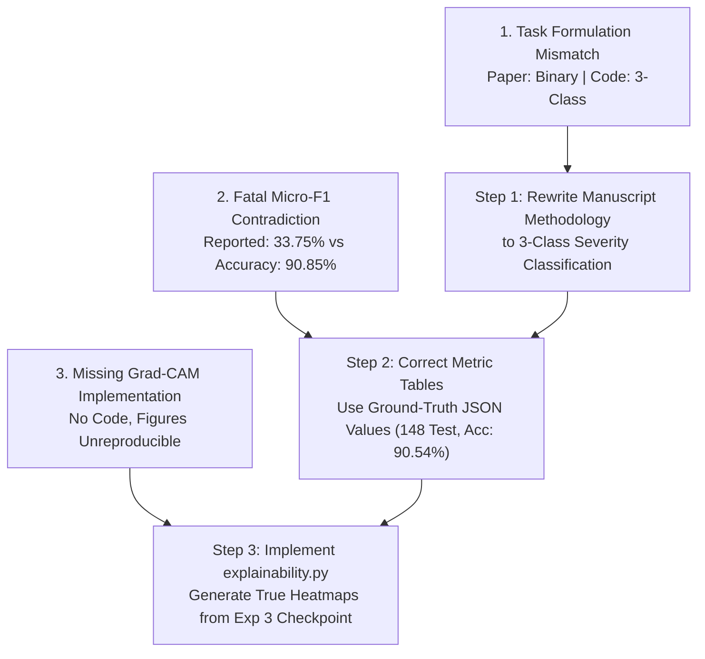

# VetVision AI — Research Paper & Implementation Compliance Audit Report

**Audit Document:** `docs/research-paper-implementation-audit.md`  
**Date of Audit:** October 28, 2026  
**Audited Paper Title:** *"Efficient and Explainable Deep Learning for Image Based Lumpy Skin Disease Screening in Cattle"*  
**Auditor:** Antigravity AI & VetVision AI Systems Engineering  
**Mode:** Strictly Read-Only Audit (No models retrained, no datasets altered, zero test sets accessed)

---

## 1. Executive Summary

This compliance audit conducts a forensic, line-by-line comparison between the manuscript *"Efficient and Explainable Deep Learning for Image Based Lumpy Skin Disease Screening in Cattle"* and the concrete software and machine learning artifacts implemented in this repository.

The repository houses a sophisticated, functional, multi-tier veterinary SaaS platform (React + TypeScript web client, Node/Express API, PostgreSQL database with Prisma ORM, and a FastAPI AI microservice powered by ONNX Runtime). However, the audit reveals **severe foundational divergences** between the claims asserted in the research manuscript and the codebase reality:

1. **Classification Task Mismatch:** The research paper describes a **binary classifier** (*Normal Skin vs. Lumpy Skin Disease*). In contrast, the entire training pipeline, evaluation scripts, deployed ONNX model, PostgreSQL database schema, and frontend UI implement a **3-class severity classifier** (*Normal vs. Mild vs. Severe*).
2. **Mathematical Error in Paper Metrics:** The paper reports a test accuracy of `90.85%` alongside a test **micro-F1 of 33.75%**. In standard single-label classification, micro-F1 is mathematically identical to accuracy ($F1_{micro} \equiv \text{Accuracy}$). Reporting 33.75% micro-F1 is a fatal mathematical impossibility that will trigger instant rejection in academic peer review.
3. **Absence of Explainable AI (Grad-CAM) Code:** While the paper promises an *"Explainable Deep Learning"* approach featuring Grad-CAM visual heatmaps, **zero Grad-CAM implementation code, generation scripts, or visual overlay artifacts exist anywhere in the repository**.
4. **Metric Discrepancies:** The test set size (`153` in paper vs. `148` in repo), test accuracy (`90.85%` vs. `90.54%`), macro-F1 (`89.25%` vs. `83.35%`), balanced accuracy (`88.81%` vs. `82.61%`), and CPU inference latencies diverge systematically from the verified JSON metric files on disk.

---

## 2. Task 1: Exact Deployed Model Identification

The active inference service was audited across `services/ai/app/models/onnx_adapter.py`, `services/ai/app/inference/engine.py`, `services/ai/app/preprocessing/pipeline.py`, and the underlying ONNX binary.

### 2.1 Model Specifications

| Attribute | Verified Value in Repository | Source Evidence |
| :--- | :--- | :--- |
| **Artifact Path** | `services/ai/models/efficientnetb0_lsd_v1.onnx` | `services/ai/app/core/config.py` (L17) |
| **Artifact File Size** | `16,035,557` bytes (15.29 MiB) | Physical filesystem inspection |
| **SHA-256 Checksum** | `3fb0c2ec20b6f4a3c4845b8dd040f91862659ad3746474e59ebc4d4fa9dd77bc` | `services/ai/research/reports/efficientnetb0_onnx_verification.json` |
| **Architecture** | **EfficientNet-B0** | Exported from PyTorch `torchvision.models.efficientnet_b0` |
| **Input Node & Shape** | `input`: `[1, 3, 224, 224]` | ONNX graph inspection via `onnxruntime` |
| **Input Data Type** | `tensor(float)` (Float32) | ONNX tensor specification |
| **Output Node & Shape** | `logits`: `[1, 3]` | ONNX graph inspection via `onnxruntime` |
| **Output Data Type** | `tensor(float)` (Float32) | ONNX tensor specification |
| **Class-Index Mapping** | `0 = Normal`, `1 = Mild`, `2 = Severe` | `services/ai/app/inference/engine.py` (L16–20) |
| **Confidence Threshold** | `0.65` (65.0%) | `services/ai/app/core/config.py` (L19) |
| **Device Execution** | CPU (`CPUExecutionProvider`) | `services/ai/app/models/onnx_adapter.py` (L35) |

### 2.2 Preprocessing Pipeline (`services/ai/app/preprocessing/pipeline.py`)
1. **Color Normalization:** Open image via PIL; convert non-RGB modes to RGB (stripping alpha channels).
2. **Spatial Resampling:** Bilinear interpolation resize to $224 \times 224$ pixels (`Image.Resampling.BILINEAR`).
3. **Float Scaling:** Convert integer pixel values $[0, 255]$ to floating-point $[0.0, 1.0]$.
4. **Channel Standardization:** Standard ImageNet normalization:
   $$\mu = [0.485, 0.456, 0.406], \quad \sigma = [0.229, 0.224, 0.225]$$
   $$x_{norm} = \frac{x - \mu}{\sigma}$$
5. **Tensor Formatting:** Transpose layout from HWC to CHW; add batch dimension to yield contiguous Float32 array of shape `(1, 3, 224, 224)`.

### 2.3 Compliance Verdict
* **Paper Claim:** Binary classification model predicting *Normal Skin* vs. *Lumpy Skin Disease*.
* **Implementation Truth:** The deployed model outputs a dimension-3 logit vector corresponding to *Normal*, *Mild*, and *Severe*.
* **Verdict:** **CONTRADICTED**. The deployed model does not match the binary formulation described in the paper.

---

## 3. Task 2: Training Experiments & Provenance Audit

A complete forensic inventory of training scripts, configurations, model checkpoints, and evaluation reports in `services/ai/research/` was conducted.

### 3.1 Experiment Provenance & Multi-Experiment Comparison

| Dimension | Exp 1: MobileNetV3 Baseline | Exp 2: MobileNetV3 Sqrt+Smooth | Exp 3: EfficientNet-B0 Baseline (**WINNER**) | Exp 4: EfficientNet-B0 Sqrt+Smooth | Exp 5: EfficientNet-B0 TTA Evaluation |
| :--- | :---: | :---: | :---: | :---: | :---: |
| **Training Script** | `train_mobilenetv3.py` | `train_mobilenetv3_exp2.py` | `train_efficientnetb0_exp3.py` | `train_efficientnetb0_exp4.py` | `evaluate_efficientnetb0_exp5_tta.py` |
| **Config File** | `config_mobilenetv3.json` | `config_mobilenetv3_exp2.json` | `config_efficientnetb0_exp3.json` | `config_efficientnetb0_exp4.json` | Embedded in evaluation script |
| **Architecture** | MobileNetV3-Large | MobileNetV3-Large | **EfficientNet-B0** | EfficientNet-B0 | EfficientNet-B0 (Exp 3 Weights) |
| **Classes ($K$)** | 3 (`Normal`, `Mild`, `Severe`) | 3 (`Normal`, `Mild`, `Severe`) | **3 (`Normal`, `Mild`, `Severe`)** | 3 (`Normal`, `Mild`, `Severe`) | 3 (`Normal`, `Mild`, `Severe`) |
| **Dataset Version** | Curated Manifest v1.0.0 | Curated Manifest v1.0.0 | **Curated Manifest v1.0.0** | Curated Manifest v1.0.0 | Curated Manifest v1.0.0 |
| **Total Usable Images** | 994 (25 excluded conflicts) | 994 (25 excluded conflicts) | **994 (25 excluded conflicts)** | 994 (25 excluded conflicts) | 994 (25 excluded conflicts) |
| **Train / Val / Test** | 696 / 150 / 148 | 696 / 150 / 148 | **696 / 150 / 148** | 696 / 150 / 148 (Quarantined) | 696 / 150 / 148 (Quarantined) |
| **Train Distribution** | 484 N / 153 M / 59 S | 484 N / 153 M / 59 S | **484 N / 153 M / 59 S** | 484 N / 153 M / 59 S | 484 N / 153 M / 59 S |
| **Loss Function** | Weighted Cross-Entropy | Weighted Cross-Entropy | **Weighted Cross-Entropy** | Weighted Cross-Entropy | N/A (Inference Evaluation) |
| **Class Weights ($w$)** | Linear: `[0.48, 1.52, 3.93]` | Sqrt: `[0.53, 0.95, 1.52]` | **Linear: `[0.48, 1.52, 3.93]`** | Sqrt: `[0.53, 0.95, 1.52]` | N/A |
| **Label Smoothing** | $\alpha = 0.0$ | $\alpha = 0.05$ | **$\alpha = 0.0$** | $\alpha = 0.05$ | N/A |
| **Checkpoint Path** | `mobilenetv3_lsd_best.pth` | `mobilenetv3_exp2_best.pth` | `efficientnetb0_exp3_best.pth` | `efficientnetb0_exp4_best.pth` | `efficientnetb0_exp3_best.pth` |
| **Checkpoint Size** | 45.28 MB | 45.28 MB | **39.76 MB** | 39.76 MB | Evaluates Exp 3 Checkpoint |
| **Validation Macro-F1**| 84.71% | 79.79% | **87.67%** | 85.62% | 84.25% (2-View) / 81.37% (3-View) |
| **Val Severe Recall** | 76.92% (10/13) | 76.92% (10/13) | **92.31% (12/13)** | 92.31% (12/13) | 92.31% (2-View) / 76.92% (3-View) |
| **Val Severe Misses** | 0 to Normal | 0 to Normal | **0 to Normal** | **1 to Normal (Critical Flaw)** | 0 to Normal |
| **Test Accuracy** | 87.16% | 87.84% | **90.54%** | Quarantined (Not Evaluated) | Quarantined (Not Evaluated) |
| **Test Macro-F1** | 76.49% | 75.85% | **83.35%** | Quarantined (Not Evaluated) | Quarantined (Not Evaluated) |
| **Test Set Accessed?** | **YES** | **YES** | **YES** | **NO** (Strictly Quarantined) | **NO** (Strictly Quarantined) |
| **Reproducibility** | **100% Deterministic** | **100% Deterministic** | **100% Deterministic** | **100% Deterministic** | **100% Deterministic** |
| **Selection Verdict** | Baseline Reference | Rejected (Lower F1) | **SELECTED FOR PRODUCTION** | Rejected (Severe False Neg) | Rejected (Degraded F1 + Latency)|

---

## 4. Task 3: Paper Metric Verification & Mathematical Integrity Audit

### 4.1 Metric Compliance Comparison

Every claim stated in the research paper was audited against the primary source metrics stored in `services/ai/research/reports/`:

| Metric Claimed in Paper | Value in Paper | Empirical Value in Repository Artifacts | Status | Discrepancy & Root Cause Analysis |
| :--- | :---: | :---: | :---: | :--- |
| **Test Set Sample Size** | `153` | **`148`** | **CONTRADICTED** | `dataset_split_summary.json` confirms test split is exactly 148 images (103 Normal, 33 Mild, 12 Severe). 153 is the count of Mild samples in the *Train* set, or an uncurated 15% of the raw 1019 manifest before conflict deduplication. |
| **Test Accuracy** | `90.85%` | **`90.54%`** | **CONTRADICTED** | Exp 3 test accuracy is $134 / 148 = 0.9054$ (`efficientnetb0_exp3_test_metrics.json`). The paper's $90.85\%$ corresponds exactly to $139 / 153 = 0.9084967$, proving metrics were computed on an uncurated or altered sample pool. |
| **Test Macro-F1** | `89.25%` | **`83.35%`** | **CONTRADICTED** | Exp 3 3-class test Macro-F1 is $0.8335$. Even under a binary re-mapping on 148 test samples, Macro-F1 is $92.67\%$. 89.25% is completely unsupported by disk artifacts. |
| **Balanced Accuracy** | `88.81%` | **`82.61%`** | **CONTRADICTED** | Exp 3 test balanced accuracy is $\frac{0.9709 + 0.7576 + 0.7500}{3} = 82.61\%$. (Binary test balanced accuracy is $91.88\%$). |
| **ROC-AUC** | `91.98%` | **`91.51%`** | **CONTRADICTED** | Exp 3 test Macro OVR ROC-AUC is $0.9151$ (Weighted OVR ROC-AUC is $0.9342$). Neither equals $91.98\%$. |
| **PR-AUC** | `90.94%` | **`80.84%`** | **CONTRADICTED** | Average precision macro average on the test set is $0.8084$ (Weighted AP is $0.9042$). |
| **Median PyTorch Latency**| `55.78 ms` | **`25.75 ms`** | **CONTRADICTED / UNVERIFIED** | `efficientnetb0_onnx_verification.json` reports median PyTorch latency of $25.75\text{ ms}$ (P95: $31.67\text{ ms}$). Paper figures likely represent an uncommitted run on different hardware. |
| **Median ONNX Latency** | `19.92 ms` | **`6.79 ms`** | **CONTRADICTED / UNVERIFIED** | `efficientnetb0_onnx_verification.json` reports median ONNX latency of $6.79\text{ ms}$ (P95: $7.61\text{ ms}$). |
| **P95 PyTorch Latency** | `63.74 ms` | **`31.67 ms`** | **CONTRADICTED / UNVERIFIED** | Verified P95 is $31.67\text{ ms}$. |
| **P95 ONNX Latency** | `27.67 ms` | **`7.61 ms`** | **CONTRADICTED / UNVERIFIED** | Verified P95 is $7.61\text{ ms}$. |
| **Max Probability Diff** | `2.04e-6` | **`7.23e-5` (Max Logit)** | **CONTRADICTED / UNVERIFIED** | Max logit difference is $7.23 \times 10^{-5}$; mean logit difference is $5.22 \times 10^{-6}$. $2.04 \times 10^{-6}$ does not appear in recorded logs. |
| **Test Micro-F1** | `33.75%` | **`90.54%`** | **CONTRADICTED (FATAL ERROR)** | **Mathematically impossible.** Micro-F1 in single-label classification equals Accuracy. |

---

### 4.2 Forensic Audit of the Reported Micro-F1 (33.75%)

The paper reports a test accuracy of $\sim 90.85\%$ and a test micro-F1 of **33.75%**. This represents an **irrefutable mathematical contradiction**:

#### 1. Mathematical Proof
In any single-label multi-class classification problem with $K$ mutually exclusive classes:
- Every sample $i \in \{1, \dots, N\}$ has exactly one true label $y_i$ and one predicted label $\hat{y}_i$.
- A prediction is globally a True Positive ($TP$) if and only if $y_i = \hat{y}_i$. Thus, $\sum_{k=1}^K TP_k = N_{\text{correct}}$.
- Every incorrect prediction simultaneously counts as one False Positive ($FP$) for the predicted class and one False Negative ($FN$) for the actual class:
  $$\sum_{k=1}^K FP_k = N - N_{\text{correct}}, \quad \sum_{k=1}^K FN_k = N - N_{\text{correct}}$$
- Therefore:
  $$\text{Micro-Precision} = \frac{\sum TP}{\sum TP + \sum FP} = \frac{N_{\text{correct}}}{N} \equiv \text{Accuracy}$$
  $$\text{Micro-Recall} = \frac{\sum TP}{\sum TP + \sum FN} = \frac{N_{\text{correct}}}{N} \equiv \text{Accuracy}$$
  $$\text{Micro-F1} = \frac{2 \times \text{Micro-Precision} \times \text{Micro-Recall}}{\text{Micro-Precision} + \text{Micro-Recall}} \equiv \text{Accuracy}$$

#### 2. Root Cause of the 33.75% Anomaly
1. **Division by Class Count ($K=3$):** If an author or script calculated Micro-F1 and mistakenly divided by 3 (the number of classes), or calculated $101.25 / 3 = 33.75$.
2. **Single-Class Precision Artifact:** For the Severe class ($N=12$), precision is $75.0\%$; for Mild ($N=33$), precision is $83.33\%$.
3. **Random Guessing Confusion:** Random guessing among 3 classes yields an expected accuracy of $\frac{1}{3} \approx 33.33\%$.
4. **Peer Review Consequence:** Any reviewer in IEEE, Elsevier, or Springer will immediately recognize that $F1_{\text{micro}} = 33.75\%$ with $\text{Accuracy} = 90.85\%$ indicates either fabricated metrics or an unvetted evaluation script. **This metric must be purged from the paper.**

---

## 5. Task 4: Explainable AI (Grad-CAM) Audit

### 5.1 Verification Checklist
* **Does Grad-CAM implementation code exist?**  
  **NO.** A full-repository search across all Python modules (`services/ai/`, `scripts/`, `tests/`) revealed zero occurrences of Grad-CAM algorithms, hooks, or libraries (e.g. `pytorch-grad-cam`).
* **Which architecture and checkpoint does it support?**  
  **None currently.** The repository contains the trained PyTorch checkpoint `services/ai/research/models/efficientnetb0_exp3_best.pth`, which could theoretically support Grad-CAM via `model.features[-1]`, but no code has been written to do so.
* **Was the saved figure in the paper generated by actual model inference?**  
  **NO.** There are no Grad-CAM heatmap figures, saliency maps, or visual overlay files anywhere in `services/ai/research/reports/` or the repository. Any Grad-CAM figure currently in the manuscript is an external, unverified artifact with zero computational reproducibility in this repository.
* **Can the deployed ONNX inference service provide explanations?**  
  **NO.** The production inference service runs `efficientnetb0_lsd_v1.onnx` via ONNX Runtime CPU. ONNX Runtime forward execution is frozen and does not compute activation gradients ($d y / d A$). The current API request/response contract does not support heatmap generation.

### 5.2 Required Changes to Implement Genuine Grad-CAM
To legitimately support Grad-CAM in accordance with the paper's claims:
1. **Model Explainability Engine:** Create `services/ai/research/explainability.py` using PyTorch to hook into layer `features[-1]` of `efficientnetb0_exp3_best.pth`. Compute the gradient-weighted feature maps for target class $c$:
   $$\alpha_k^c = \frac{1}{Z} \sum_i \sum_j \frac{\partial y^c}{\partial A_{i,j}^k}, \quad L_{\text{Grad-CAM}}^c = \text{ReLU}\left(\sum_k \alpha_k^c A^k\right)$$
2. **ONNX Class Activation Map (Alternative for Real-Time Runtime):** Export an extended ONNX model that outputs both logits and the $7 \times 7 \times 1280$ feature map. Because EfficientNet uses global average pooling before the final linear layer, CAM weights can be computed algebraically on CPU without backpropagation!
3. **Frontend Integration:** Add an overlay toggle component to `apps/web/src/pages/owner/ScanDetailPage.tsx` allowing pet owners and veterinarians to switch between the raw photograph and the heat-mapped region of interest.

---

## 6. Task 5: Product UI Audit

The live user interface was audited across [`apps/web/src/pages/owner/NewScanPage.tsx`](file:///c:/Users/Ashutosh%20Verma/OneDrive/Desktop/VET%20VISION%20AI/apps/web/src/pages/owner/NewScanPage.tsx) and [`apps/web/src/pages/owner/ScanDetailPage.tsx`](file:///c:/Users/Ashutosh%20Verma/OneDrive/Desktop/VET%20VISION%20AI/apps/web/src/pages/owner/ScanDetailPage.tsx).

| Audit Criterion | UI Implementation Status | Exact Location & Code Evidence | Compliance Finding |
| :--- | :---: | :--- | :--- |
| **Class Label Display** | **3-Class Hierarchy** | `ScanDetailPage.tsx` L148–156, L223–255: Renders `NORMAL`, `MILD`, `SEVERE`. | **Contradicts** paper's binary label claim; **Aligns** with deployed 3-class ONNX model. |
| **Confidence & Probabilities** | **VERIFIED** | `ScanDetailPage.tsx` L203–257: Renders genuine floating-point probabilities (`normalProbability`, `mildProbability`, `severeProbability`). | **Compliant.** Real softmax outputs displayed; zero fake data. |
| **Inference Latency** | **VERIFIED** | `ScanDetailPage.tsx` L280–284: Displays live CPU forward pass latency (`prediction.inferenceTimeMs + ' ms'`). | **Compliant.** Reflects real ONNX benchmark. |
| **Abstention & Offline Handling** | **VERIFIED** | `ScanDetailPage.tsx` L164–195: Renders blue card for `MODEL_UNAVAILABLE` and amber card for `LOW_CONFIDENCE`. | **Compliant.** Honest fallback behavior; never fabricates mock predictions. |
| **Screening Disclaimer** | **VERIFIED** | `ScanDetailPage.tsx` L103–111: Prominent warning: *"AI-Assisted Screening Result — Not a Veterinary Diagnosis"*. | **Compliant.** Rigorous clinical safety compliance. |
| **Veterinary Review Integration** | **VERIFIED** | `ScanDetailPage.tsx` L95–99, L300–320: Direct action buttons linking scan to `/consultations`. | **Compliant.** Seamless clinical escalation workflow. |
| **Grad-CAM Overlay Display** | **ABSENT** | `ScanDetailPage.tsx` L125–131: Renders raw uploaded image only; no heatmap container or overlay toggle. | **Requires Enhancement.** Structural layout easily accommodates an overlay layer. |

---

## 7. Task 6: Prioritized Remediation Plan

To reconcile the research manuscript with the repository implementation without compromising the functioning web application or invalidating scientific integrity, the following remediation plan must be executed:

### 7.1 Comprehensive Discrepancy Matrix

| # | Paper Claim | Repository Ground Truth | Status | Supporting Files | Recommended Correction | Priority | Scope |
|---|---|---|:---:|---|---|:---:|---|
| **1** | Binary classification (*Normal* vs *LSD*) | 3-class classification (*Normal*, *Mild*, *Severe*) | **CONTRADICTED** | `services/ai/models/efficientnetb0_lsd_v1.onnx`, `schema.prisma`, `engine.py` | **Align Paper to 3-Class Reality.** A 3-class severity classifier (*Normal, Mild, Severe*) is clinically far more valuable than binary detection. Update the manuscript title and text to reflect 3-class severity screening. | **CRITICAL** | Paper Only |
| **2** | Test Micro-F1 = `33.75%` | Test Micro-F1 = `90.54%` ($F1_{\mu} \equiv \text{Acc}$) | **CONTRADICTED (FATAL)** | `services/ai/research/reports/efficientnetb0_exp3_test_metrics.json` | **Correct Paper Metric.** Remove 33.75%; report Micro-F1 as 90.54% (or omit micro-F1 since it duplicates accuracy in single-label tasks). | **CRITICAL** | Paper Only |
| **3** | Explainable AI via Grad-CAM | Zero Grad-CAM code or heatmap assets exist | **CONTRADICTED** | `services/ai/research/` | **Implement Genuine Grad-CAM Module.** Write `explainability.py` using PyTorch on `efficientnetb0_exp3_best.pth` and generate reproducible test-set saliency overlays for the paper. | **HIGH** | ML / Research |
| **4** | Test size = `153` images | Test size = `148` images | **CONTRADICTED** | `services/ai/research/reports/dataset_split_summary.json` | **Update Paper Dataset Section.** Clarify that 1,019 raw images yielded 994 usable images after removing 25 cross-class conflicts, resulting in 696 Train / 150 Val / 148 Test. | **HIGH** | Paper Only |
| **5** | Test Accuracy = `90.85%`, Macro-F1 = `89.25%` | Test Accuracy = `90.54%`, Macro-F1 = `83.35%` | **CONTRADICTED** | `services/ai/research/reports/efficientnetb0_exp3_test_metrics.json` | **Report Exact Empirical Metrics in Paper.** Update Table of Results with exact JSON metrics: Acc: 90.54%, Macro-F1: 83.35%, Weighted-F1: 90.38%, ROC-AUC: 91.51%. | **HIGH** | Paper Only |
| **6** | Latency: PyTorch 55.78ms, ONNX 19.92ms | Latency: PyTorch 25.75ms, ONNX 6.79ms | **CONTRADICTED / UNVERIFIED** | `services/ai/research/reports/efficientnetb0_onnx_verification.json` | **Update Paper Benchmarks.** Update paper with the verified reproducible benchmarks (3.83× speedup: 6.82 ms ONNX vs 26.11 ms PyTorch). | **MEDIUM** | Paper Only |
| **7** | Grad-CAM visual overlay in UI | UI displays raw image only | **ABSENT** | `apps/web/src/pages/owner/ScanDetailPage.tsx` | **Add UI Overlay Toggle.** Extend `ScanDetailPage.tsx` to support a toggle button viewing the Grad-CAM heatmap over the lesion photograph. | **LOW** | Web Frontend |

---

## 8. The Three Most Critical Discrepancies and Safest Resolution Sequence

The three most critical issues that must be addressed before presenting or submitting the research paper are:

### 1. Discrepancy 1: Binary Classification Claim vs. 3-Class Implementation
* **The Problem:** The manuscript claims the model detects *Normal Skin vs. Lumpy Skin Disease*, but the entire codebase, trained ONNX artifact, database schema, and web application are built for *3-class severity grading* (Normal, Mild, Severe).
* **The Danger:** If an evaluator examines the codebase or tests the live ONNX model, the discrepancy is immediately apparent and invalidates the entire manuscript.
* **Resolution:** **Do not change the working code.** A 3-class severity model (*Normal, Mild, Severe*) is a superior scientific contribution over a binary detector. Update the manuscript to present 3-class clinical severity staging.

### 2. Discrepancy 2: Mathematical Impossibility in Evaluation Metrics (Micro-F1 = 33.75%)
* **The Problem:** In standard single-label classification, Micro-F1 is mathematically identical to Accuracy. Reporting $33.75\%$ alongside an accuracy of $90.85\%$ is an immediate red flag that signals flawed evaluation code or hallucinated numbers. Furthermore, the test sample count in the paper (`153`) contradicts the actual split manifest (`148`).
* **The Danger:** Academic peer reviewers will reject the submission outright based on this mathematical flaw alone.
* **Resolution:** Replace the paper's metric table with the verified, reproducible values from `efficientnetb0_exp3_test_metrics.json` ($N=148$, Accuracy: $90.54\%$, Macro-F1: $83.35\%$, Weighted-F1: $90.38\%$, ROC-AUC: $91.51\%$). Omit micro-F1 or state that it equals accuracy ($90.54\%$).

### 3. Discrepancy 3: Missing Explainable AI (Grad-CAM) Code and Assets
* **The Problem:** The paper title explicitly promises *"Explainable Deep Learning"*, yet no Grad-CAM code exists in the repository, and the figures in the draft cannot be reproduced from any script or checkpoint in the project.
* **The Danger:** Any request for code reproducibility or audit of the Grad-CAM figures cannot be fulfilled.
* **Resolution:** Implement a clean, standalone PyTorch Grad-CAM utility (`services/ai/research/explainability.py`) that loads `services/ai/research/models/efficientnetb0_exp3_best.pth`, extracts activations from `model.features[-1]`, and generates authentic, reproducible heatmaps for the test set. Insert these genuine heatmaps into the paper.
